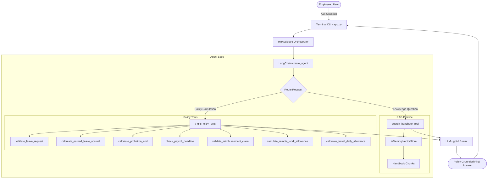

# PROITBRIDGE AI HR Assistant (Sprint 5)

An intelligent, policy-grounded HR Assistant built with **LangChain**, **OpenAI GPT models**, and **Retrieval-Augmented Generation (RAG)**. The assistant resolves common employee policy inquiries and executes deterministic HR calculations directly aligned with the official company handbook.

---

## 📌 Business Problem & Motivation

In any growing organization, HR departments are repeatedly asked standard policy and calculation questions:
- *"Can I take casual leave during probation?"*
- *"When does my probation end if I joined on 2026-03-01?"*
- *"How many earned leave days do I accumulate after 6 months?"*
- *"What is my daily travel allowance for a Tier 1 / Metro city?"*

Answering these manually takes valuable HR time and risks inconsistent interpretations. This AI HR Assistant automates routine policy inquiries and calculations by grounding responses in the official **PROITBRIDGE Employee Handbook** and executing Python validation tools.

---

## 🚀 Key Features & Capabilities

1. **Intelligent Agent Routing (`create_agent`)**:
   - Routes user queries dynamically between handbook retrieval and calculation tools.
   - Decides whether a tool is required or if it can directly formulate a response.

2. **RAG Knowledge Retrieval (`search_handbook`)**:
   - Ingests and indexes the company handbook using `PyPDFLoader`, `RecursiveCharacterTextSplitter`, and `InMemoryVectorStore` with OpenAI embeddings (`text-embedding-3-small`).
   - Retrieves relevant policy clauses on demand as a tool rather than a rigid pipeline.

3. **7 Deterministic HR Calculation & Validation Tools**:
   - **`validate_leave_request`**: Validates whether a specific leave application (Earned Leave, Casual Leave, Sick Leave) adheres to notice period and probation rules.
   - **`calculate_earned_leave_accrual`**: Calculates exact accrued Earned Leave (EL) based on completed service months (1.75 days per month).
   - **`calculate_probation_end`**: Computes the exact probation end date and confirmation eligibility based on joining date (standard 6-month period).
   - **`check_payroll_deadline`**: Checks payroll submission cutoff dates and normal salary credit dates (last working day of the month).
   - **`validate_reimbursement_claim`**: Validates expense reimbursement submissions against policy windows (30-day submission limit, original receipts requirement).
   - **`calculate_remote_work_allowance`**: Returns monthly internet/utility allowance based on designated work models (Remote-First, Hybrid, In-Office).
   - **`calculate_travel_daily_allowance`**: Computes per diem meal and incidentals allowances based on employee grade level and destination city tier (Metro, Tier 1, Tier 2).

4. **Python-Level Pre-Validation**:
   - Validates tool inputs before returning decisions, preventing hallucinated calculations.

---

## 🏗️ Architecture



---

## 📁 Project Structure

```
Sprint5_AI_HR_Assistant/
├── .env.example           # Environment template for OpenAI credentials
├── .gitignore             # Git ignore file (excludes PDFs, .env, and virtual environments)
├── app.py                 # Interactive terminal chat interface
├── LICENSE                # MIT License
├── README.md              # Project documentation
├── requirements.txt       # Python dependencies
├── data/
│   ├── .gitkeep           # Keeps directory in git
│   └── PROITBRIDGE_Employee_Handbook_2026_1.pdf  # (Excluded from git) Place PDF here
└── src/
    ├── __init__.py        # Package initialization
    ├── assistant.py       # High-level assistant interface and execution tracer
    ├── chain.py           # LangChain model and create_agent setup
    ├── config.py          # Centralized configuration (models, thresholds, paths)
    ├── prompts.py         # Agent system prompt and persona definitions
    ├── rag.py             # Document loading, splitting, vector store & search tool
    └── tools.py           # 7 HR calculation & validation tools
```

> [!NOTE]
> The employee handbook PDF (`PROITBRIDGE_Employee_Handbook_2026_1.pdf`) is deliberately ignored from GitHub version control via `.gitignore` to protect internal company data. Place your handbook PDF inside the `data/` folder before running.

---

## ⚙️ Installation & Setup

### 1. Clone the Repository

```bash
git clone https://github.com/teevvr7/Sprint5_AI_HR_Assistant.git
cd Sprint5_AI_HR_Assistant
```

### 2. Set Up Virtual Environment

```bash
# Windows
python -m venv .venv
.venv\Scripts\activate

# macOS / Linux
python3 -m venv .venv
source .venv/bin/activate
```

### 3. Install Dependencies

```bash
pip install -r requirements.txt
```

### 4. Configure Environment Variables

Create a `.env` file based on `.env.example`:

```bash
# Copy example file
copy .env.example .env    # Windows CMD
cp .env.example .env      # Linux / macOS / PowerShell
```

Edit `.env` and insert your OpenAI API key:

```env
OPENAI_API_KEY=sk-proj-xxxxxxxxxxxxxxxxxxxx
```

### 5. Place Employee Handbook

Ensure the handbook PDF is located at:
```
data/PROITBRIDGE_Employee_Handbook_2026_1.pdf
```

---

## 🖥️ Usage

Run the terminal application:

```bash
python app.py
```

Upon startup, the assistant loads and indexes the handbook once, then enters an interactive prompt:

```text
=======================================================
PROITBRIDGE HR Assistant
=======================================================
Ask a question about PROITBRIDGE HR policy.
Type 'exit' to quit.

Examples:
  - What is the casual leave policy?
  - How much EL will I accrue after 6 completed months?
  - Can I take 5 days of EL during probation?
  - What is the daily travel allowance for Grade 3 in a metro city?

Ask your HR question:
> 
```

---

## 💡 Example Queries to Test

| Query Category | Example Prompt | Mechanism Used |
| :--- | :--- | :--- |
| **Policy Inquiries** | *"What is the casual leave policy?"* | `search_handbook` (RAG) |
| **Policy Inquiries** | *"What is the code of conduct regarding gifts?"* | `search_handbook` (RAG) |
| **Leave Calculations** | *"How much EL will I accrue after 8 completed months?"* | `calculate_earned_leave_accrual` |
| **Leave Validation** | *"Can I take 5 days of EL during probation with 3 days notice?"* | `validate_leave_request` |
| **Probation Tracking**| *"I joined on 2026-01-15. When does my probation period end?"* | `calculate_probation_end` |
| **Payroll Inquiries** | *"When is salary credited, and what is the cutoff for reimbursement?"* | `check_payroll_deadline` + `search_handbook` |
| **Travel Allowance**  | *"What is the daily allowance for a Grade 2 employee visiting a Metro city?"*| `calculate_travel_daily_allowance` |
| **Expense Claims**    | *"I incurred travel expenses on 2026-02-01. Can I submit a claim on 2026-03-10?"* | `validate_reimbursement_claim` |

---

## 🔒 Security & Best Practices

- **Secrets Management**: `.env` is explicitly ignored in `.gitignore` to prevent secret leaks.
- **Data Privacy**: Proprietary company handbook PDFs in `data/` are omitted from version control.
- **Deterministic Validations**: Financial and leave eligibility checks execute via strictly validated Python code rather than model approximations.

---

## 📄 License

This project is licensed under the [MIT License](LICENSE).
